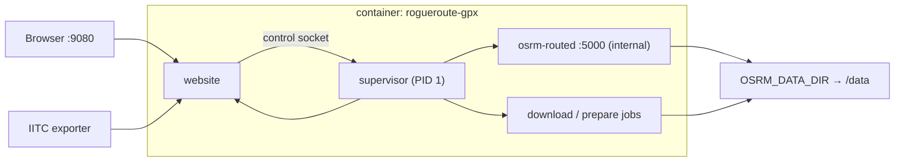

<div align="center">


# RogueRoute GPX

**Turn portal lists and coordinates into practical, path-following GPX routes.**

[](https://github.com/RogueAssassin/rogueroute-gpx/releases)
[](https://github.com/RogueAssassin/rogueroute-gpx/pkgs/container/rogueroute-gpx)
[](#requirements)
[](#requirements)

Version **13.0.0** · One container · Local OSRM routing with automatic regions

</div>

RogueRoute GPX accepts IITC exports, JSON, CSV and coordinate lists, routes them along OpenStreetMap roads and walking tracks, and exports GPX files that are detailed enough to follow without overwhelming GPX applications.

Everything runs in **one container**, `rogueroute-gpx`: the website, the OSRM routing engine, region switching, and map download and preparation. It runs the same way on Docker and on rootless Podman, and it never needs access to the container engine socket.

## Why RogueRoute GPX?

| | What you get |
| --- | --- |
| 🥾 | **Follow the real path.** Local OSRM routing uses mapped roads, footways and walking tracks instead of drawing straight lines. |
| 🌏 | **Automatic regions.** Paste waypoints anywhere you have a prepared map; RogueRoute picks the matching region and loads it. |
| 🧲 | **Recover difficult portals.** Strict routing searches progressively from 250 m up to a configurable 5,000 m snap limit. |
| 🗺️ | **See the route before export.** The map shows the route, the original waypoints, automatic snap corrections and failures. |
| 📦 | **Manageable GPX files.** Automatic mode targets 1,000 track points by default, with Compact and Full alternatives. |
| 🧰 | **Maps managed in place.** Resumable Geofabrik downloads and OSRM preparation run inside the container, from the CLI or the website. |
| 🐳 | **One container.** No sidecars, no engine socket, no shared secrets volume. |

## Install from scratch

### Requirements

- 64-bit AMD64 or ARM64 Linux
- Docker Engine with Docker Compose v2, or rootless Podman with Podman Compose
- Git, Bash and OpenSSL
- Port `9080` for the web interface
- A folder for downloaded `.osm.pbf` and prepared `.osrm*` files, with enough space and RAM
  for the regions you want (see `./rogueroute-gpx osm list`)

### 1. Clone into the permanent folder

```bash
sudo install -d -o "$USER" -g "$(id -gn)" /opt/media-server/rogueroute-gpx
git clone https://github.com/RogueAssassin/rogueroute-gpx.git /opt/media-server/rogueroute-gpx
cd /opt/media-server/rogueroute-gpx
```

### 2. Install, start and build the first region

```bash
./install.sh --data-dir /mnt/h/osrm --region new-zealand --start
```

The installer writes the ignored `.env`, sets the container user to your account, starts
the container, then downloads and prepares the region if it is not prepared already. Run it
without `--start` to only configure.

### 3. Open RogueRoute GPX

Visit `http://SERVER-IP:9080`. Change `HOST_PORT` in `.env` if port 9080 is taken.

## How it works



- The **supervisor** starts the website and `osrm-routed` as child processes. To switch region
  it stops `osrm-routed` and starts it on the other graph. If the new graph fails to load, it
  goes back to the previous one. The last served region is saved in
  `OSRM_DATA_DIR/.rogueroute-gpx/state.json`.
- When you **generate a route**, the website finds the prepared region whose area contains all
  your waypoints (the active region first, otherwise the smallest match, so Germany beats
  Europe) and switches to it if needed. Pick a region in the **Map region** panel to override.
- Region switches are global (one OSRM serves every visitor), so they are serialised and
  rate-limited by `OSRM_SWITCH_COOLDOWN_SECONDS`.
- The image is built from the official `ghcr.io/project-osrm/osrm-backend` image, so the OSRM
  tools and routing profiles are upstream's own.

## Day-to-day commands

```bash
./rogueroute-gpx start          # pull and start the container
./rogueroute-gpx update         # after git pull: apply VERSION, migrate, pull, recreate
./rogueroute-gpx doctor         # configuration, permissions, container and OSRM state
./rogueroute-gpx logs
./rogueroute-gpx stop           # map data is kept

./rogueroute-gpx osm status     # active region and every region's state
./rogueroute-gpx osm download japan
./rogueroute-gpx osm prepare japan
./rogueroute-gpx osm switch japan  # optional: routes switch automatically
```

See the [command reference](docs/commands.md) and [maps guide](docs/osm.md).

## Configuration

Machine-specific settings live in `/opt/media-server/rogueroute-gpx/.env` and must not be
committed. The most useful ones:

| Setting | Default | Purpose |
| --- | --- | --- |
| `OSRM_DATA_DIR` | `/mnt/h/osrm` | Map folder, mounted at `/data` |
| `OSRM_ACTIVE_REGION` | `australia` | Region loaded on the very first start |
| `OSRM_SWITCH_COOLDOWN_SECONDS` | `60` | Minimum time between automatic or public switches |
| `ADMIN_TOKEN` | empty | Set to a long random value to download and prepare maps from the website |
| `HOST_BIND` / `HOST_PORT` | `0.0.0.0` / `9080` | Where the website is published |
| `PUID` / `PGID` | your account | Container user, so map files stay yours |
| `ROGUEROUTE_RUNTIME` | `auto` | `podman`, `docker`, or detect a running engine |
| `GPX_MAX_TRACK_POINTS` | `1000` | Point budget for Automatic GPX detail |

## GPX detail modes

| Mode | Behaviour | Best for |
| --- | --- | --- |
| **Automatic** | Cleans duplicates and raises simplification tolerance only when needed to meet the configured point budget | Normal use |
| **Compact** | Uses stronger simplification for a smaller GPX file | Older or limited GPX applications |
| **Full** | Keeps the OSRM geometry apart from invalid and adjacent duplicate points | Inspection and archival use |

Automatic simplification does not remove submitted waypoints or routed leg boundaries.

## Rogue Dashboard

The container joins the `rogueroute-gpx` and `media-net` networks and still answers as
`rogueroute-gpx-web`, so existing Rogue Dashboard settings keep working. The cards use
`/api/health` (website) and `/api/health/osrm` (routing engine).

## Documentation

- [Installation](docs/install.md)
- [Maps: download, prepare, switch](docs/osm.md)
- [Upgrading, including from v12](docs/upgrading.md)
- [Troubleshooting](docs/troubleshooting.md)
- [Command reference](docs/commands.md)
- [v13.0.0 release notes](docs/releases/v13.0.0.md)

## Development

```bash
npm install --global pnpm@11.24.0
pnpm install --frozen-lockfile
pnpm typecheck
pnpm test
pnpm build
docker build -t rogueroute-gpx:dev .
```

`pnpm dev` runs the website on its own; without the supervisor it routes against
`OSRM_URL` (default `http://127.0.0.1:5000`) and skips automatic region switching.

The supported toolchain is Node.js `26.8.1`, pnpm `11.24.0` and TypeScript `6.0.3`. Pushing to
`main` or publishing a release builds AMD64 and ARM64 images. The `testing` branch publishes
`ghcr.io/rogueassassin/rogueroute-gpx:testing`.

## Acknowledgements

Routing data is provided by [OpenStreetMap contributors](https://www.openstreetmap.org/copyright),
regional extracts by [Geofabrik](https://download.geofabrik.de/), and route calculation by
[OSRM](https://project-osrm.org/) (BSD-2-Clause), which is bundled in the container image.
