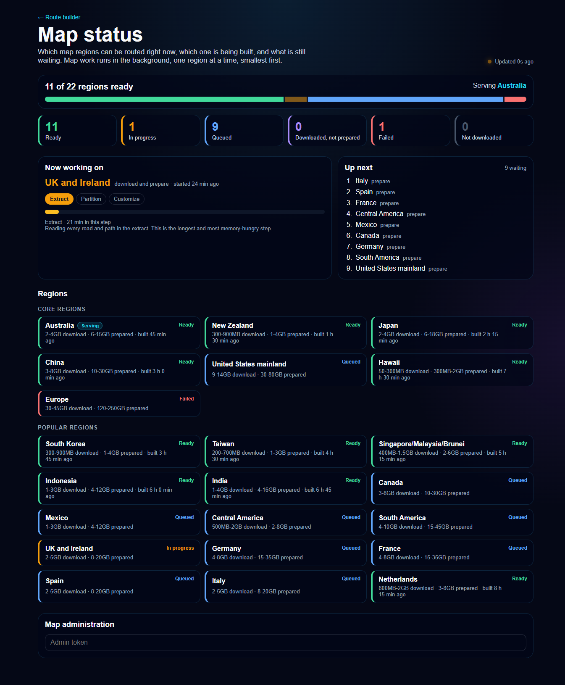

# rogueroute-gpx v13.1.0 — Background map queue and /maps

v13.1.0 makes map preparation hands-off and visible.



## Highlights

- **Background map queue.** Ask for regions with `./rogueroute-gpx osm add REGION…` (or from
  `/maps`) and the container downloads and prepares them one at a time, smallest first, at a
  lower CPU priority so routing stays responsive. The queue is saved in
  `OSRM_DATA_DIR/.rogueroute-gpx/queue.json` and resumes after `update`, `restart` or a reboot.
- **Automatic preparation.** Regions that are downloaded but not prepared are queued when the
  container starts (`ROGUEROUTE_AUTO_PREPARE=true`).
- **Clear failures.** A region that fails is recorded with its step and reason (for example
  `osrm-extract` killed for lack of memory) and the queue moves on. `osm retry` queues it again.
  Free disk space is checked before downloads and preparation, and a warning is logged when a
  region probably needs more memory than the container has.
- **`/maps` status page.** Public and read-only: how many regions are ready, the region being
  built with its step, download progress, speed and elapsed time, the waiting list, and every
  region's state. With `ADMIN_TOKEN` it also manages the queue and shows the log, free disk and
  memory.

## Command changes

| v13.0 | v13.1 |
| --- | --- |
| `osm download R` (waits) | `osm download R` queues; add `--wait` to wait |
| `osm prepare R` (waits, needs the download first) | `osm add R` / `osm prepare R` queues download and preparation; `--wait` to wait |
| `osm job` | `osm follow` |
| — | `osm queue`, `osm queue pause` / `resume` / `cancel` / `clear` / `remove R`, `osm retry`, `osm prepare-all` |

## New settings

| Setting | Default | Purpose |
| --- | --- | --- |
| `ROGUEROUTE_AUTO_PREPARE` | `true` | Queue downloaded but unprepared regions at start |
| `ROGUEROUTE_PREPARE_THREADS` | all cores | Cores used by `osrm-extract`, `-partition`, `-customize` |
| `ROGUEROUTE_PREPARE_NICE` | `10` | CPU priority of preparation (0–19) |

## Upgrade

```bash
cd /opt/media-server/rogueroute-gpx && git pull --ff-only
./rogueroute-gpx update
./rogueroute-gpx osm status
```

A v13.0 job that is running during the update stops. Its region stays downloaded, so the
queue picks it up again when the container starts. See [upgrading](../upgrading.md).
