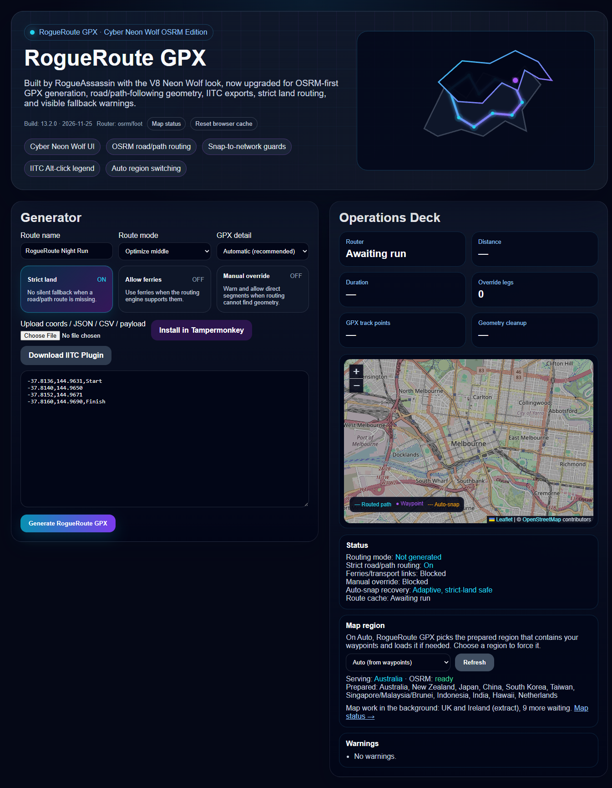

# rogueroute-gpx v13.2.0 — v13.1 fixes rolled up, documentation refresh

v13.2.0 brings everything since v13.1.0 together as one stable release and refreshes the
documentation. There are no new settings and nothing to change in `.env` or the map data.



## Fixed

- **Stale Podman pods** (from v13.1.1). `start`, `restart` and `update` failed under
  podman-compose with `Error: no pod with name or ID pod_rogueroute-gpx found` when a container
  outlived its pod. The script now removes the previous container and, on Podman, the
  `pod_rogueroute-gpx` pod after pulling the image and before starting.
- **Flaky map-queue test.** A unit test could start a simulated restart before the queue had
  finished writing `queue.json`. Test-only; the queue itself was correct.
- **CI test maps.** The container test downloads Andorra and San Marino from the
  openstreetmap.fr mirror, because Geofabrik refuses connections from GitHub runners at times.

## Documentation

- README: an **Updating** section with the stable and testing channels, their branches and
  image tags; `ROGUEROUTE_CHANNEL` and `OSRM_PROFILE` in the configuration table; links to all
  release notes and the changelog; refreshed screenshots. OpenSSL is no longer a requirement.
- [Upgrading](../upgrading.md): rolling back within v13 with `./rogueroute-gpx update --no-fetch`,
  and a v13.1 to v13.2 note.
- [Troubleshooting](../troubleshooting.md): the stale-pod error and its manual fix for older
  checkouts.

## Upgrade

```bash
cd /opt/media-server/rogueroute-gpx
./rogueroute-gpx update
```

From v13.0 or the testing branch, switch the checkout to `main` once first:

```bash
git fetch origin && git checkout main && git pull --ff-only
./rogueroute-gpx update stable
```
