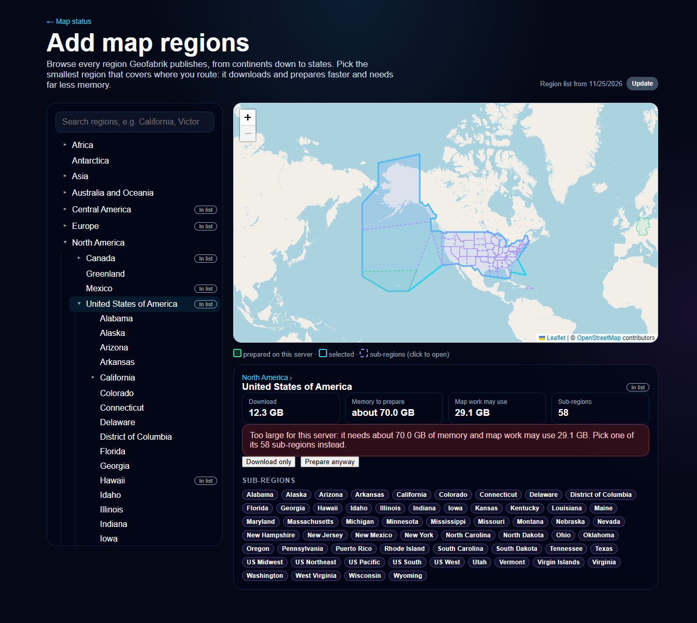

# rogueroute-gpx v13.4.0 — Add any region: downloader page and region outlines

v13.3.0 stopped regions such as the whole United States and Europe from taking the server
down by refusing them when they need more memory than the server allows. v13.4.0 makes the
answer easy: pick a smaller region, from any of the roughly 550 that Geofabrik publishes.



## Downloader page

Open `http://SERVER-IP:9080/maps/download`, or **Add regions** on Map status.

- **Browse or search** continents, countries and their sub-regions: US states and the US West,
  Midwest, Northeast and South; German, French and Italian regions; Australian states; Canadian
  provinces, and more.
- **See it on a map.** The selected region's outline, its sub-regions (click one to open it) and
  every region already prepared on the server.
- **Know before you download.** Download size (asked from Geofabrik), the memory needed to
  prepare it, the memory map work may use, and whether a prepared region already covers it.
  Regions that are too large say so and point to their sub-regions.
- **Add it.** With the admin token: **Download and prepare**, **Download only**, or **Prepare
  anyway** for a region over the estimate. Added regions without files can be removed again.

## Command line

```bash
./rogueroute-gpx osm search oregon          # find a region's Geofabrik id
./rogueroute-gpx osm add us/oregon us-west  # add and queue; ids and list names can be mixed
```

## Better automatic region choice

Regions now carry their real Geofabrik outline. When you generate a route, the waypoints are
matched against those outlines instead of rectangles, so a route near a border picks the
region that actually contains it, and added states or provinces are chosen over the country
or continent around them.

## Upgrade

```bash
cd /opt/media-server/rogueroute-gpx
./rogueroute-gpx update
```

Nothing in `.env` changes. If `us` or `europe` showed "too large", add sub-regions (for example
`./rogueroute-gpx osm add us-west us-south`) and delete their large `.osm.pbf` files from
`OSRM_DATA_DIR` to free the disk space. See [upgrading](../upgrading.md).
