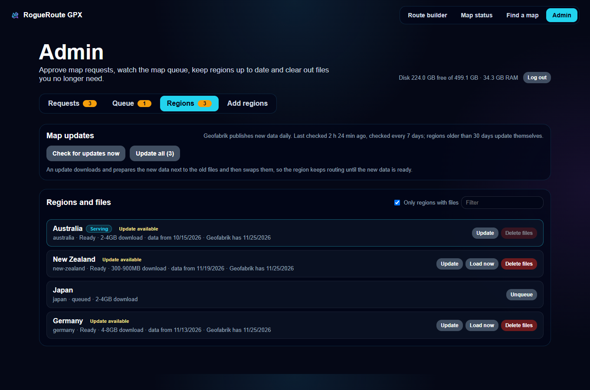

# rogueroute-gpx v13.5.0 — Admin page, map requests and map updates

v13.4.0 made any Geofabrik region easy to add. v13.5.0 adds an admin page to run the map
library from the browser, lets visitors ask for the maps they need, and keeps downloaded
regions up to date.



## Admin page

Set `ADMIN_PASSWORD` in `.env`, run `./rogueroute-gpx restart` and log in at
`http://SERVER-IP:9080/admin`.

- **Requests**: maps visitors asked for, how often, and their notes. **Download and prepare**
  adds the region and queues it; **Dismiss** closes the request.
- **Queue**: what is being built and what waits; pause, resume, cancel, retry, clear; failure
  reasons and the map log.
- **Regions**: every region's files, the date of its data and whether Geofabrik has newer data;
  prepare, update, load now, **Delete files**, remove an added region from the list.
- **Add regions**: the region browser with the admin actions.

The password replaces the admin token. If `ADMIN_TOKEN` was set, `./rogueroute-gpx update`
moves its value to `ADMIN_PASSWORD`, so the same value logs you in. `/maps` is now read-only for
everyone.

## Map requests

When waypoints are outside every prepared region, the route builder names the region that
covers them and offers **Request the … map**. Any region can also be requested from **Find a
map** (`/maps/download`). Repeated requests for a region are counted, not duplicated.

## Up-to-date maps

Once a week the container asks Geofabrik for the date of each downloaded region. Regions with
newer data show **Update available**; regions older than 30 days are updated automatically.
An update builds the new data next to the old files and then swaps it in, so the region keeps
routing until it is ready, and the region being served falls back to the old data if the new
graph does not load.

```bash
./rogueroute-gpx osm updates --check
./rogueroute-gpx osm update --all
./rogueroute-gpx osm delete europe --yes
```

Settings: `ROGUEROUTE_UPDATE_CHECK_DAYS` (7, 0 = never) and `ROGUEROUTE_AUTO_UPDATE_DAYS` (30,
0 = only report).

## Easier to find your way

Every page has tabs for Route builder, Map status, Find a map and Admin.

## Upgrade

```bash
cd /opt/media-server/rogueroute-gpx
./rogueroute-gpx update
```

See [upgrading](../upgrading.md#from-v134-to-v135).
